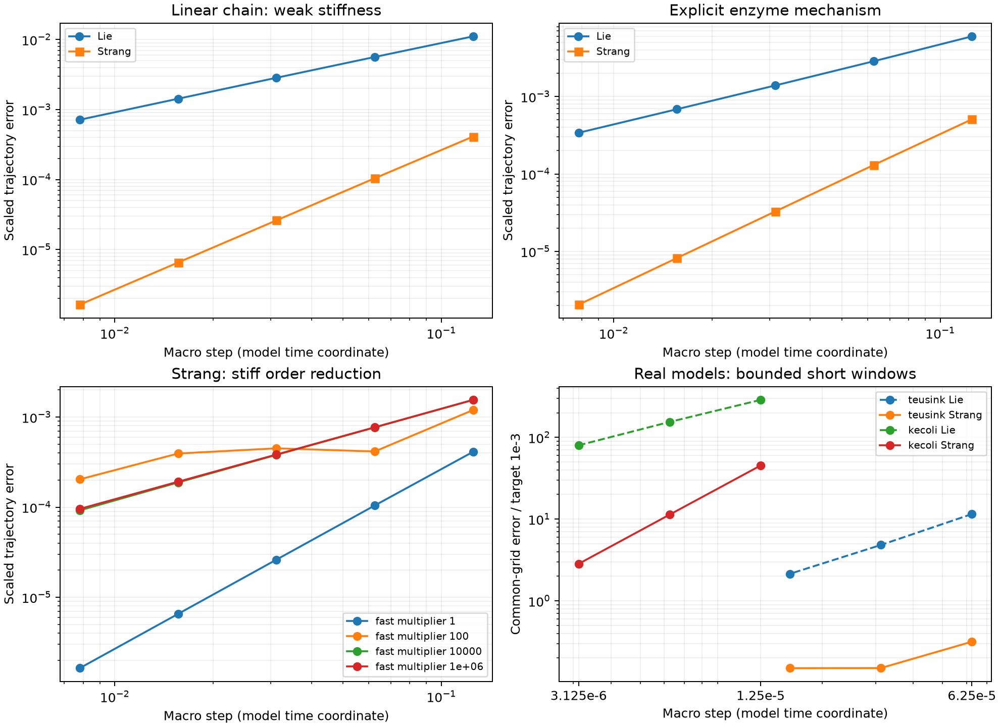
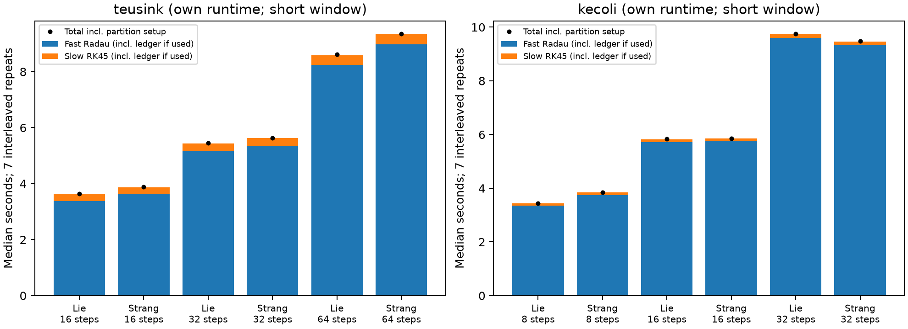

# M2 固定无 PE 分裂验收

日期：2026-11-03（Asia/Shanghai）。

**M2 通过：22/22 项保存证据检查通过。** 实现固定 Lie（快整步、慢整步）和 Strang（快半步、慢整步、快半步）；快流 Radau、慢流 RK45。没有 PE、QSSA、动态分组、外层自适应、投影或浓度裁剪。

## 小系统正确性

线性 `A ⇌ B → C` 与 `A ⇌ B ⇌ C` 使用独立完整矩阵指数作参考，子流为精确可逆对公式。扫描快反应速率的名义倍率 1、10²、10⁴、10⁶，快对速率为 `(3,2)×倍率`，慢对为 `(0.4,0.2)` 或 `(0.4,0)`。准确的孤立组非零模态比另存于 JSON；名义倍率不冒称完整 Jacobian 刚度比。远离／处于初始快平衡两类初值，每种执行 8、16、32、64、128 个宏步。弱刚性最后两档 Lie 阶数接近 1、Strang 接近 2。

| 小系统 | 方法 | 最后两档观测阶数 |
|---|---|---|
| terminal_chain | Lie | 0.9942, 0.9971 |
| terminal_chain | Strang | 1.9988, 1.9998 |
| reversible_chain | Lie | 0.9940, 0.9969 |
| reversible_chain | Strang | 1.9993, 1.9998 |
| E+S ⇌ ES → E+P | Lie | 1.0194, 1.0099 |
| E+S ⇌ ES → E+P | Strang | 1.9976, 1.9992 |

酶结合流用 Riccati 方程的精确解、催化流用指数解；没有消去 ES。数值子流组合与精确子流组合最大差 `1.07e-13`，两个独立守恒池最大绝对误差 `4.12e-15`。完整 ODE 的 Radau／DOP853 参考差 `1.11e-13`。

Robertson 初始层从 `[1,0,0]` 开始，8 次固定分裂均保留原不可逆反应；步长细化误差下降。特意构造的越出非负域流触发明确失败，未经裁剪的负值及失败原因保存在 `b0.json`。

## 刚性边界

高快慢倍率下 Strang 在当前网格上不能维持二阶。例如可逆链、远平衡初值、倍率 10⁶ 的最后观测阶约为 1.002。倍率 10² 的跨初始层网格还出现非单调误差。这些是保留的负结果；不能据 Strang 名义阶数直接采用 M3 的除以 3 估计器。

## 真实模型短窗探针

使用原始模型初值、M1 冻结的浓度／通量尺度；分组在整条轨迹固定。只缩减化学计量列不更新的坐标，速率仍读取完整状态；大模型使用原始正反向对和解析稀疏 Jacobian。短窗属于 M1 登记窗口的子集，**不代表已通过 M1 全窗口的浓度或通量精度门**。没有对子流路径作任意 Strang 插值。

| 模型 | 窗口 | 快更新坐标 | 最严格新参考交叉差（目标单位） |
|---|---|---:|---|
| teusink | 0–0.001 min | 6 | concentration: 0.000169, flux: 0.000254 |
| kecoli | 0–0.0001 source coordinate | 267 | concentration: 0.000407, flux: 0.000407, net_flux: 0.00188 |

下表为较紧子流容差 `rtol=10^-10`。E 为各自全部宏步端点的误差；另存所有方法共用粗网格的误差，用于公平的细化趋势检查。每配置预热一次、正式交错重复七次，保存全部成功和失败记录。

| 模型 | 方法 | 宏步数 | 浓度 E(10^-3) | 基元／净反应速率 E(10^-3) | 总体净通量 E(10^-3) | 中位秒（IQR） |
|---|---|---:|---:|---:|---:|---:|
| teusink | Lie | 16 | 11.52 | 40.71 | — | 3.640 (0.195) |
| teusink | Strang | 16 | 0.3164 | 0.7438 | — | 3.878 (0.108) |
| teusink | Lie | 32 | 6.456 | 23.19 | — | 5.445 (0.324) |
| teusink | Strang | 32 | 0.2057 | 0.7599 | — | 5.636 (0.239) |
| teusink | Lie | 64 | 3.32 | 12.02 | — | 8.613 (0.887) |
| teusink | Strang | 64 | 0.2342 | 0.8544 | — | 9.351 (0.382) |
| kecoli | Lie | 8 | 287.3 | 287.3 | 1.221e+05 | 3.443 (0.253) |
| kecoli | Strang | 8 | 45.24 | 45.24 | 976 | 3.846 (0.105) |
| kecoli | Lie | 16 | 154.4 | 154.4 | 6.042e+04 | 5.830 (0.290) |
| kecoli | Strang | 16 | 11.35 | 11.35 | 859.6 | 5.862 (0.351) |
| kecoli | Lie | 32 | 79.92 | 79.92 | 2.96e+04 | 9.749 (1.270) |
| kecoli | Strang | 32 | 2.839 | 2.839 | 476.3 | 9.476 (0.469) |

大模型本次扫描的最好浓度 E(10^-3) 为 `2.839`，最好总体净通量 E(10^-3) 为 `476.3`。这些数字直接决定相应配置是否达标；求解器成功不等于精度通过。M2 的继续条件是弱刚性基础阶数、正确收支及负值检测，本次真实模型探针不承担 M3 的完整误差控制验收。

子流容差 `10^-9 → 10^-10` 引起的浓度轨迹变化，最大仅为对应分裂误差的 `2.21e-06`。所有正式运行的接受子步／子流末态守恒误差最大 `4.86e-15`。监测 RHS 参数（含 Newton／有限差分探针）、接受子步、子流末态和宏步；显著负值直接报错，未声称能观测求解器内部未传给 RHS 的全部线性代数状态。

Teusink 的 Strang 误差在当前强刚性初始层没有呈现干净的二阶趋势：全部宏步端点的浓度误差可能随细化反而上升，因为更细的网格采到了更早的初始层；共用粗网格误差也趋于停滞。不能用粗网格的单调性掩盖这一现象。

Teusink 对编码反应列做碳权重浓度记账，独立 4／8 点 Gauss 积分核验开放贡献；高能磷酸 P 权重为零，NAD／NADH 权重相同。该记账不是完整培养体系物理总质量。大模型检查 456 个真正酶池，未加入 Biomass_Bulk 伪池。

## 成本与下一阶段边界

每轨迹计时包含分区矩阵构建、子求解器启动、RHS、Jacobian、分解、接受子步诊断和开放收支积分；模型读取与一次性固定分组另列 setup。参考生成、误差后处理和绘图离线执行。快／慢时间已包含收支审计，ledger_seconds 是其中的子集，不能重复相加。子求解器失败前的 RHS 调用仍计数；nfev/njev/nlu 仅累计已返回的子求解器结果。没有取得每轨迹进程峰值内存，本阶段不比较内存效率。

Windows Teusink 与 WSL 大模型时间不能交叉比较；本阶段也未对相同短窗重测成熟基线，因此不计算加速倍数。反复重启的成本已经可见。

**M3 可继续做：**冻结／动态分组消融、滞回、外层误差控制及原子回滚；先校准强耦合、切换与初始层的估计器，必要时缩步或完整系统回退。先测试完整登记窗口，再谈达标效率。M3 尚未实现，PE 仍不准入。

## 复现

```powershell
uv run python -m unittest discover -s tests -v
uv run python -m metabolism.m2_experiments --case b0
uv run python -m metabolism.m2_experiments --case teusink
```

Ubuntu／WSL（沿用 M1 环境与软件包清单）：

```bash
python3 -m metabolism.m2_experiments --case kecoli
```

最后回到 Windows：

```powershell
uv run python -m metabolism.m2_report --run-tests
uv run python -m metabolism.m2_report --check
```

`--check` 复核保存证据及指纹，失败返回非零退出码；不会运行数值求解器。测试额外覆盖保留完整调控依赖、共享物种、非单位体积适配、拒绝非自治 Chassagnole 和非法反应分组。




