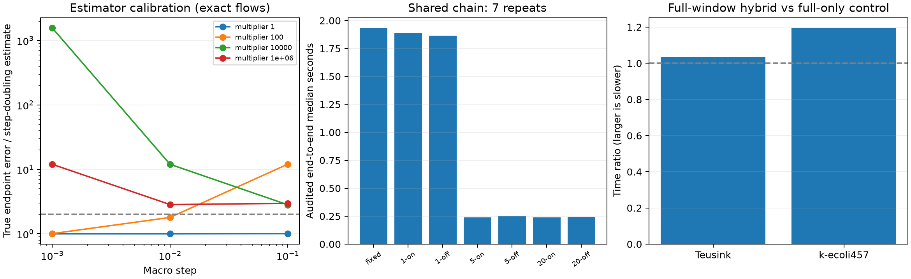

# M3 动态分组、步长与回退阶段报告

实施：2026-11-03 至 2026-11-04；验收：2026-11-04（Asia/Shanghai）。

**正确性检查 43/43 通过；M3 完成本阶段实验与继续／停止判断。** 当前实现是逐步审计的分裂—完整 ODE 混合原型。实际效率条件未得到支持，**不准入 M4／PE**。

## 实现及误差边界

按完整反应组的尺度化 Jacobian 无穷范数筛查；进入阈值 1、退出 0.3（无滞回消融取 1）。比较固定分组与每 1／5／20 个接受宏步更新；拒步立即重估。慢系统的尺度化 Jacobian 范数乘步长若超过 2，视为保守耦合报警，回退完整系统；这不是非线性稳定性证明。

粗步和两个细步始终使用同一冻结分组；估计 `(y_f-y_c)/3`，接受 `y_f`，不作外推。控制器按 `clip(0.2,2,0.9 E^(-1/3))` 更新；分组改变禁止继承增长，控制器没有隐式 PI 历史。拒步后核验时间、状态、分组、缓存、分组历史及已提交开放收支均未变化；仅诊断计数和日志保留。

M2 的刚性阶降低意味着不能直接信任二阶估计。每次候选都从相同起点用独立 Radau 完整 ODE 审计中点和终点，同时检查浓度最大分量、WRMS、速率及已登记净通量。局部审计预算为外层目标的 0.1 倍；子流初值为局部容差的 0.05 倍（上限 10^-8）。端点误差超过估计的 2 倍且大于 0.1 个局部目标单位时，判为超出已校准区间，回退完整系统。超标拒步最多连续 4 次；不通过缩小偏差审计频率制造收益。

完整系统审计和回退是两种不同用途：审计只决定候选是否可信，不把其轨迹冒充已接受分裂解；回退明确从最后已接受状态继续。合成／小模型用稀疏 BDF 回退，大模型用同 RHS、解析 Jacobian 的 CVODE-KLU。在已知常值输入边界停止并换用单独模型对象，浓度连续，分组与控制历史重新初始化；不跨事件套自治公式。

## 校准、反例与消融

144 个精确子流／完整矩阵指数局部样例中，朴素 WRMS 规则有 **14 个错误接受**；逐步中点／终点最大分量审计全部拦截。另构造 100 维单分量反例：WRMS 小于 1，而最大分量超过 1。阈值 1.5／2／4 的敏感性记录保留，阈值不能替代独立审计，也不是一般误差定理。

分组进入阈值另在开发链测试 0.5／1／2（退出阈值取进入值的 0.3 倍）；共享链、显式酶机制及 Teusink 两个轨迹状态还执行固定分组、相同宏步的子流容差 10^-8 → 10^-9 检查。这些是单次精度敏感性核验，不是重复计时或留出集泛化证据。

共享线性链的固定／动态、1／5／20 周期、滞回开／关共 7 配置，每配置一次预热及 7 次交错重复。高倍率初始层、非线性双酶池、Robertson 零初值和已知输入切换均以完整系统独立参考检查；登记验证中最大全轨迹误差为 `0.3213` 个目标单位。

| 共享链配置 | 浓度 E(10^-3) | 接受／拒步 | 分组切换 | 回退覆盖时间 | 中位秒（IQR） |
|---|---:|---:|---:|---:|---:|
| fixed | 0.0597 | 28/0 | 1 | 0.000% | 1.9296 (0.0221) |
| dynamic-1-hysteresis | 0.05449 | 28/0 | 1 | 0.000% | 1.8878 (0.0508) |
| dynamic-1-single-threshold | 0.0603 | 29/0 | 4 | 0.000% | 1.8644 (0.0776) |
| dynamic-5-hysteresis | 3.277e-07 | 2/0 | 0 | 97.000% | 0.2396 (0.0103) |
| dynamic-5-single-threshold | 3.277e-07 | 2/0 | 0 | 97.000% | 0.2511 (0.0106) |
| dynamic-20-hysteresis | 3.277e-07 | 2/0 | 0 | 97.000% | 0.2407 (0.0055) |
| dynamic-20-single-threshold | 3.277e-07 | 2/0 | 0 | 97.000% | 0.2425 (0.0106) |

低频更新在本例中可能错过步长增长后需要的快组，触发慢耦合保护。这能安全回退，但不能把更早回退造成的较低耗时归功于动态分裂。

## 真实模型完整登记窗口

沿用 M1 原始初值、模型指纹、物种／通量尺度、公共输出网格和完整窗口：Teusink 0–10 min；k-ecoli457 0–1 来源积分坐标。浓度／速率目标测试 10^-3 和 10^-5，大模型净通量目标为 10^-3。每种目标均重复完整的 7 配置；同一诊断包装另运行完整系统控制组。所有配置各预热一次并交错重复 7 次。连同共享链共 273 次正式运行、39 次预热，全部完成；单次开发校准与探针不计入正式重复数。

| 模型 | 配置／目标 | 浓度 E | 速率 E | 净通量 E(10^-3) | 回退覆盖时间 | 中位秒（IQR） |
|---|---|---:|---:|---:|---:|---:|
| teusink | fixed-0.001 | 1.28e-08 | 4.6e-08 | — | 99.99999982% | 2.964 (0.070) |
| teusink | dynamic-1-hysteresis-0.001 | 1.28e-08 | 4.66e-08 | — | 99.99999982% | 2.831 (0.070) |
| teusink | dynamic-1-single-threshold-0.001 | 1.28e-08 | 4.66e-08 | — | 99.99999982% | 2.807 (0.103) |
| teusink | dynamic-5-hysteresis-0.001 | 1.28e-08 | 4.66e-08 | — | 99.99999982% | 2.837 (0.101) |
| teusink | dynamic-5-single-threshold-0.001 | 1.28e-08 | 4.66e-08 | — | 99.99999982% | 2.746 (0.072) |
| teusink | dynamic-20-hysteresis-0.001 | 1.28e-08 | 4.66e-08 | — | 99.99999982% | 2.782 (0.037) |
| teusink | dynamic-20-single-threshold-0.001 | 1.28e-08 | 4.66e-08 | — | 99.99999982% | 2.796 (0.092) |
| teusink | fixed-1e-05 | 1.28e-06 | 4.6e-06 | — | 99.99999982% | 2.919 (0.034) |
| teusink | dynamic-1-hysteresis-1e-05 | 1.28e-06 | 4.66e-06 | — | 99.99999982% | 2.825 (0.041) |
| teusink | dynamic-1-single-threshold-1e-05 | 1.28e-06 | 4.66e-06 | — | 99.99999982% | 2.776 (0.047) |
| teusink | dynamic-5-hysteresis-1e-05 | 1.28e-06 | 4.66e-06 | — | 99.99999982% | 2.805 (0.029) |
| teusink | dynamic-5-single-threshold-1e-05 | 1.28e-06 | 4.66e-06 | — | 99.99999982% | 2.818 (0.145) |
| teusink | dynamic-20-hysteresis-1e-05 | 1.28e-06 | 4.66e-06 | — | 99.99999982% | 2.771 (0.044) |
| teusink | dynamic-20-single-threshold-1e-05 | 1.28e-06 | 4.66e-06 | — | 99.99999982% | 2.793 (0.109) |
| teusink | full-only-0.001 | 1.72e-08 | 4.65e-08 | — | 100.00000000% | 2.705 (0.101) |
| teusink | full-only-1e-05 | 1.72e-06 | 4.65e-06 | — | 100.00000000% | 2.711 (0.061) |
| kecoli | fixed-0.001 | 1.74e-06 | 1.01e-06 | 0.00108 | 99.99999995% | 4.437 (0.190) |
| kecoli | dynamic-1-hysteresis-0.001 | 2.14e-06 | 1.61e-06 | 0.000837 | 99.99999995% | 4.236 (0.291) |
| kecoli | dynamic-1-single-threshold-0.001 | 2.14e-06 | 1.61e-06 | 0.000837 | 99.99999995% | 4.218 (0.197) |
| kecoli | dynamic-5-hysteresis-0.001 | 2.14e-06 | 1.61e-06 | 0.000837 | 99.99999995% | 4.233 (0.162) |
| kecoli | dynamic-5-single-threshold-0.001 | 2.14e-06 | 1.61e-06 | 0.000837 | 99.99999995% | 4.221 (0.126) |
| kecoli | dynamic-20-hysteresis-0.001 | 2.14e-06 | 1.61e-06 | 0.000837 | 99.99999995% | 4.217 (0.105) |
| kecoli | dynamic-20-single-threshold-0.001 | 2.14e-06 | 1.61e-06 | 0.000837 | 99.99999995% | 4.224 (0.147) |
| kecoli | fixed-1e-05 | 0.000174 | 0.000101 | 0.00108 | 99.99999995% | 4.455 (0.091) |
| kecoli | dynamic-1-hysteresis-1e-05 | 0.000214 | 0.000161 | 0.000837 | 99.99999995% | 4.278 (0.123) |
| kecoli | dynamic-1-single-threshold-1e-05 | 0.000214 | 0.000161 | 0.000837 | 99.99999995% | 4.236 (0.314) |
| kecoli | dynamic-5-hysteresis-1e-05 | 0.000214 | 0.000161 | 0.000837 | 99.99999995% | 4.150 (0.246) |
| kecoli | dynamic-5-single-threshold-1e-05 | 0.000214 | 0.000161 | 0.000837 | 99.99999995% | 4.193 (0.361) |
| kecoli | dynamic-20-hysteresis-1e-05 | 0.000214 | 0.000161 | 0.000837 | 99.99999995% | 4.161 (0.078) |
| kecoli | dynamic-20-single-threshold-1e-05 | 0.000214 | 0.000161 | 0.000837 | 99.99999995% | 4.206 (0.139) |
| kecoli | full-only-0.001 | 0 | 0 | 0 | 100.00000000% | 3.456 (0.186) |
| kecoli | full-only-1e-05 | 0 | 0 | 0 | 100.00000000% | 3.479 (0.198) |

**这些达标轨迹主要由完整系统回退取得，不是纯分裂完整窗口资格。** 为限制开发成本，真实模型登记最多 8 次分裂尝试；初始层公共网格极密，强制落步很早耗尽预算，回退覆盖接近整个窗口。该工程上限和输出策略本身限制了这批结果；不能从它推导所有多速率方法都无效。另有不受早期输出落步限制的大模型宏步探针。默认慢耦合保护触发正常回退；为单独检验估计器，另一次开发探针固定 145 个快组、仅在该探针将慢耦合阈值放宽到 10^6。探针状态 `success`，耗时 12.321 秒。保存 0 次接受、3 次拒步；回退原因：estimator_outside_calibrated_regime。候选的步长、WRMS、独立浓度／通量误差和回滚证据逐次保留。该配置不用于正式计时或生产接受条件。

## 一次优化核验与成本判断

按来源的相反化学计量列合并正反速率梯度，精确计算同一组 Jacobian 范数；不再逐组构造稀疏 Jacobian。四个轨迹状态均与原逐组算法吻合，保存每状态七次测量。原循环时间不含梯度，优化时间包含梯度；该不对称方向不夸大优化优势。

| 状态坐标 | 原逐组中位秒 | 优化（含梯度）中位秒 | 最大相对差 |
|---:|---:|---:|---:|
| 0 | 7.26229 | 0.00080 | 2.22e-16 |
| 0.000115 | 9.07818 | 0.00088 | 2.22e-16 |
| 0.01 | 9.17429 | 0.00119 | 2.22e-16 |
| 1 | 8.80259 | 0.00094 | 2.22e-16 |

总时间包括分组预处理／筛查、分区矩阵构建、粗细双算、子求解器重启、Jacobian／分解、独立审计、失败重试、收支诊断与完整系统回退。模型解析单列 setup；参考生成、误差后处理与绘图离线。full-only 控制组经过同一诊断包装和严格回退容差，用于量化额外尝试开销，**不是对各精度档最快成熟基线的重新选优**；不能据该控制组宣称超越 BDF／Radau／CVODE。M1 强基线原始结果仍保留。

即使某个混合配置的总时间低于 full-only 控制组，也不能据此认定动态分组产生加速：短暂预积分改变了完整系统求解器的启动状态与步长历史，而分裂覆盖时间几乎为零。该实现层差异与动态分组贡献必须分开，本阶段没有支持后者的证据。

原生 CVODE 只暴露 RHS 参数和输出，未提供所有内部接受状态或独立 LU 次数。日志分别报告 SciPy 可用 nlu 与原生 linear setup，不互相替代。未采集隔离 worker 峰值内存。所有最小值未经裁剪；拒绝试算的负值／失败与已提交轨迹分开保存。

**继续／停止决定：**逐步完整系统审计仍不可省，动态分组未展示覆盖其代价的实际收益；在核验一次分组频率、稀疏实现及重启成本后，按项目规划停止当前以加速为目标的 PE 扩展。M4 不准入，M5／M6 未自动开展。后续若要继续，应先解决输出／重启策略和廉价但可靠的估计器，再以较大分裂预算及同实际精度的强基线重验，不能删除安全检查来得到加速。

## 复现

```powershell
uv run python -m metabolism.m3_experiments --case calibration
uv run python -m metabolism.m3_experiments --case toy
uv run python -m metabolism.m3_experiments --case sensitivities
uv run python -m metabolism.m3_experiments --case teusink
uv run python -m metabolism.m3_experiments --case teusink-full
```

Ubuntu／WSL（M1 环境）：

```bash
python3 -m metabolism.m3_experiments --case kecoli
python3 -m metabolism.m3_experiments --case kecoli-full
python3 -m metabolism.m3_experiments --case screening
```

`screening` 默认复用已保存的四状态筛查计时，并重跑宏步探针；加 `--refresh-screening` 才重新测量筛查。探针记录内部 20 秒及外部 30 秒超时边界，失败／超时也保存，不补造不可取得的内部计数。

最后回到 Windows：

```powershell
uv run python -m metabolism.m3_report --run-tests
uv run python -m metabolism.m3_report --check
```

`--check` 只重算保存轨迹的误差、验收条件和 SHA-256，不运行积分。M1／M2 的验收文件及其证据保持原样；M3 额外核验这些历史指纹，新的测试源码集合独立登记。


