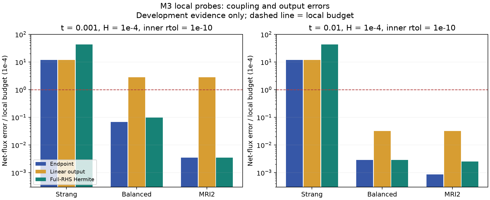

# M3 瓶颈研究：快慢耦合、净通量与连续输出

2026-11-07（Asia/Shanghai）；`test` 分支。前序 macOS 工作已作为 `0516865` 推送。

**建议把下一轮 M3 的主线改为“带慢驱动的 MRI-GARK + 完整 RHS 连续输出 + 通量感知误差控制”，把 balanced splitting 作为消融对照。** 本轮已经在真实大模型上验证局部精度改善，尚未解决完整窗口效率问题，M4／PE 仍不准入。

## 1. 先区分三种瓶颈

1. **组合偏差：**历史冻结分组实验中，`h=10^-4` 的 Strang 端点净通量误差约 11.9 个局部单位，子流容差从 `10^-8` 收紧到 `10^-12` 仍不消失。本轮换用统一 CVODE-KLU 子流后仍重现约 11.9，说明只换快流求解器不能消除这一偏差。
2. **输出偏差：**即使端点已经很准，两端凸线性插值仍可能遗漏初始层曲率。本轮 MRI 的端点净通量误差已降到 0.00349，但四分点线性输出仍为 2.78，必须单独修复。
3. **成本：**当前每个粗步加两个细步需要多次重新创建 CVODE、初始化 BDF 历史和分解。原同机完整窗口强基线约 1.4 秒，而本轮一个局部 MRI 试算仍需约 0.3–1 秒。局部精度改善不能直接换算成加速。

分组器已优化到毫秒量级，继续优化分类器不是第一优先级。单纯扩大快组、加尝试预算、降低审计频率也不是本轮证据支持的解法。

## 2. 文献给出的具体方法

### 带慢驱动的 MRI-GARK：主线

Sandu 的 MRI-GARK 把慢阶段信息作为 forcing 放进快子问题。对 `y'=f(y)+g(y)`，`f` 为快反应、`g` 为慢反应，本轮实现其 arXiv v3 式 (2.8) 的二阶显式中点形式，改写为物理半步时间：

$$
z_1'=f(z_1)+g(y_n),\quad z_1(0)=y_n,\quad 0\le\tau\le H/2,
$$

$$
Y_2=z_1(H/2),\qquad
z_2'=f(z_2)-g(y_n)+2g(Y_2),\quad z_2(0)=Y_2,
\quad 0\le\tau\le H/2.
$$

取 `y_{n+1}=z_2(H/2)`。慢驱动在快弛豫过程中持续存在，避免 Strang 把快慢过程依次关闭造成的偏移。在完整稳态 `f(y*)+g(y*)=0` 上，两段 RHS 都为零，因而在精确子流意义下保持这个稳态。这不等于把每个快反应强制置为平衡，没有实施 PE 或模型降阶。

该二阶格式本身不是新方法，也不自动保证刚性统一精度或正性。Sandu 摘要对有利应用区域有明确限制；不能据其高阶条件保证当前反应分组处处稳定。Chinomona–Reynolds 的 IMEX-MRI-GARK 提供了慢分量仍有刚性时的进一步路线，其实验也保留了阶降低和高阶方法稳定域受限的现象。因此先验证低阶耦合机制，再考虑成熟三阶实现，不直接堆高阶。

### Balanced splitting：低改动对照

Speth 等把两个子场改成 `f+c_n`、`g-c_n`，其中 simple balanced splitting 取

$$c_n=\tfrac12[g(y_n)-f(y_n)].$$

本轮按照其式 (5.1)–(5.6) 做对称组合。它保持完整稳态，并在较晚状态明显改善误差；但在 `t=0.001, H=0.001` 的初始层样例中仍明显失准。原文 §6 明确展示 simple balanced splitting 的稳定性限制，§7–8 的 rebalanced splitting 使用历史信息改进稳定性。**本轮没有实现 rebalanced，不将 simple 的结果归到 rebalanced 名下。**

由于 `L f=L g=0`，上述两种耦合构造在精确算术下仍满足 `L y=常量`。但 forcing／常量偏移可能破坏子流的正性，须保留负值拒绝和独立审计。开放系统收支须按修改后的子流重新记账，不能直接照搬原 Strang 账本。

## 3. 实际运行的 24 个局部探针

使用 k-ecoli457 原始模型和初值，实际积分到 `t=0.001`、`0.01`，不用保存参考状态初始化。两个状态各按固定规则 `10^-3 κ_g≥0.01` 选出 1641 个完整快组；在同一状态下，全部方法、步长和容差共享这份分组。快反应更新 1946 个坐标，慢反应更新 1329 个坐标，存在共享坐标。

扫描 `H=10^-6,10^-4,10^-3`，子流 `rtol=10^-8`；另在 `H=10^-4` 收紧至 `10^-10`。3 方法 × 2 状态 × 4 配置，共 24 次，全部完成。每次计算一个粗步、两个细步，接受细步仅用于离线比较；这里没有新的自适应控制器或生产接受动作。

全部子流统一使用同一 CVODE-KLU，包括 Strang 的慢流，且保留全部 3003 个坐标，以隔离耦合公式。这与历史 Radau/RK45 子流不同，不把两批耗时作正式比较。参考是独立完整 ODE，`rtol=10^-12`，并与 `10^-11` 对照；最大参考收紧差为 0.000141 个局部单位以内。

下表统一使用历史冻结物种／单向通量／净通量尺度，三个局部目标均为 `10^-4`，误差≤1 为本次局部阈值。它不是原两档全局目标的完整窗口资格。

| 起点 t | H | 子流 rtol | 方法 | 端点净通量 E | 线性输出最大净通量 E | Hermite 输出最大净通量 E |
|---:|---:|---:|---|---:|---:|---:|
| 0.001 | 0.0001 | 1e-10 | Strang | 11.8981 | 11.9185 | 43.1204 |
| 0.001 | 0.0001 | 1e-10 | balanced | 0.06822 | 2.79444 | 0.09695 |
| 0.001 | 0.0001 | 1e-10 | MRI2 | **0.003493** | 2.78252 | **0.003493** |
| 0.01 | 0.0001 | 1e-10 | Strang | 11.9735 | 11.9927 | 43.3684 |
| 0.01 | 0.0001 | 1e-10 | balanced | 0.002882 | 0.03192 | 0.002882 |
| 0.01 | 0.0001 | 1e-10 | MRI2 | **0.0008646** | 0.03192 | **0.002534** |
| 0.01 | 0.001 | 1e-08 | MRI2 | 0.03078 | 2.98321 | **0.07537** |
| 0.001 | 0.001 | 1e-08 | MRI2 | 1.36392 | 209.911 | **5.98267（失败）** |

在第一个对照中，MRI2 端点净通量误差比统一子流 Strang 小约 3406 倍；这是**局部误差比，不是速度比**。同一时刻 `H=10^-3` 仍失败，说明不能把一个成功宏步推广成任意大步稳定。



## 4. 连续输出：完整 RHS Hermite 的有利结果与反例

对两个细步的每个区间 `[a,b]`，用数值端点及其**完整 RHS** 导数构造三次 Hermite 多项式。区间中点公式为

$$
P((a+b)/2)=\tfrac12(y_a+y_b)+\tfrac{b-a}{8}\big[F(y_a)-F(y_b)\big],\qquad F=f+g.
$$

构造仅需要三个数值节点的完整 RHS，不使用参考解。新增成本单次约 0.31–0.44 毫秒。以此替换四分点线性插值后，24 个配置中 16 个通过登记采样点的浓度、单向通量、净通量、负值和池误差检查。最大相对池漂移约 `8.81×10^-14`；所有采样输出满足登记非负阈值。

两个关键限制：

- 对原 Strang，Hermite 反而把净通量误差从约 12 放大到约 43。端点未正确耦合时，其完整 RHS 导数也可能污染插值，不能把换插值当成通用修复。
- Hermite 不是无条件保正；自检包含非负端点却在内部为负的反例。当前只独立审计四分点，尚未证明整个连续区间的正性或精度。后续可通过每个分量三次多项式的导数根检查整个区间的非负性；精度仍需独立审计，不能用正性代替精度。

## 5. 廉价估计器应该怎么改

Descombes 等的关键启发是检查估计器有效域，而非把两个近似解接近当成可靠性证据。本轮保存了粗细差除以 3 的指标，但没有将其升级为接受规则。

例如 `t=0.01, H=0.001, MRI2, rtol=10^-8`，端点粗细净通量差除以 3 约 0.02575，线性输出实际净通量误差却为 2.983。只检查端点，即使把通量加入范数，也会遗漏输出失准。更小步长上，子流误差也可能主导粗细差，不能固定相信二阶渐近比率。

推荐的待验证估计框架：

1. 控制浓度、单向通量、净通量和输出的**最大分量误差**，保留 WRMS 作为辅助量；沿用冻结尺度，净通量分母不改成单向速率大小。
2. 用 `Dq=N_net Dv` 把状态误差映射到净通量；给内层绝对容差分配预算，使 `Σ_i |Dq_ji| a_i` 不超过净通量局部预算的一部分。这个一阶敏感度约束只是设计工具，强非线性下仍需直接通量核验。
3. 在输出曲线 `P(t)` 上计算 defect `r=P'-F(P)`，研究由 `e'≈J(P)e-r` 传播的浓度／净通量误差估计。需用刚性稳定的传播近似，不能仅以 `H||r||` 或低阶交换子量代替误差界。
4. 在初始层、分组切换、两级步长和容差变化下，离线统计漏检与效应指数；保留独立完整 ODE 审计直到可靠性与成本条件满足。当前没有证据允许减少审计。

这里只提出可检验方案，没有实现或证明新的 defect 误差界。

## 6. 下一轮可直接执行的优先级

| 顺序 | 具体工作 | 通过条件／停止信号 |
|---|---|---|
| P0：局部正确性扩展 | MRI2 + Hermite；扩展到原初始层、更多实际轨迹状态和 Teusink；同组同步长收紧内层容差 | 浓度、两类通量、池、负值和开放收支均通过；保留失败，不扩大 PE 范围 |
| P1：先算成本上限 | 固定分组下减少原生分配、复用结构分析；比较单步隐式内核和当前 BDF 重启 | 把分组、输出、粗细算、审计、拒步都计入；若仍无法接近同机完整系统基线，停止效率扩展 |
| P2：可靠控制 | 验证通量敏感度权重、内外误差预算、defect 与输出误差；正确回滚分组／历史／账本 | 独立审计未漏检，且估计开销小于节约成本；只在校准域内推进 |
| P3：完整资格 | 原两模型、两档目标、原初值／网格／完整窗口，预热和 7 次交错重复 | 分开报告耦合积分覆盖和完整系统回退；满足既定精度、效率条件后再讨论 M4 |

**实现时有两处容易犯错：**

- MRI forcing 可能驱动原来不受快反应更新的坐标，不能继续将其冻结。对于 `f_I≡0` 的坐标，可以精确用 `y_I(τ)=y_I(0)+q_I τ`（常 forcing）更新；快坐标 RHS 仍必须读取这些随时间变化的值。这样才有机会从全 3003 坐标降到 1946 个快更新坐标的隐式子问题；这不是化学模型降阶。
- 分组或 forcing 改变后不能盲目沿用 BDF 多步历史或旧数值 LU。可以评估复用内存、固定稀疏结构与符号分析；数值 Jacobian／分解和历史有效性必须分别管理。单步隐式 RK／Rosenbrock 类方法值得作为重启成本对照，尚未实测。

本机 SUNDIALS 6.4.1 构建关闭了 ARKODE。最新官方文档中的 MRIStep、内外误差控制能力不等于本机已经可用，也不能静默升级 ABI。若选成熟高阶 MRI 实现，先单独验证兼容版本和构建。

## 7. 文献与实际阅读深度

| 来源 | 实际阅读 | 本轮作用 |
|---|---|---|
| Speth, Green, MacNamara & Strang (2013), *Balanced Splitting and Rebalanced Splitting*, SIAM J. Numer. Anal. 51(6), 3084–3105. [DOI](https://doi.org/10.1137/120878641)；[MIT 全文](https://dspace.mit.edu/server/api/core/bitstreams/dcb4dafb-13fb-4952-b91c-1377974dbe84/content) | 公开 PDF，23 页（含 MIT 封面）；§4–8，式 (5.1)–(5.6)、(7.7)，稳态偏差与稳定性限制 | simple balanced 实现依据，rebalanced 仅阅读 |
| Sandu (2019), *A Class of Multirate Infinitesimal GARK Methods*. [DOI](https://doi.org/10.1137/18M1205492)；[arXiv v3](https://arxiv.org/pdf/1808.02759v3) | 全文相关章节，正文 §2 Definition 2.2、Example 2.8、§6.1；本次实际版本为 2022 年 v3，不混同发表年 | MRI2 公式和耦合边界；不宣称逐项复核所有高阶条件 |
| Chinomona & Reynolds (2021), *Implicit-Explicit Multirate Infinitesimal GARK Methods*, SIAM J. Sci. Comput. 43(5), A3082–A3113. [DOI](https://doi.org/10.1137/20M1354349)；[arXiv v3](https://arxiv.org/pdf/2007.09776v3) | 全文中 §1、§5.2、§6，正文 pp.23–25 的效率、阶降低和稳定性讨论 | 慢部分仍刚性时的备用路线；本轮未实现 IMEX-MRI |
| Descombes et al. (2011), *Adaptive time splitting method for multi-scale evolutionary partial differential equations*. [DOI](https://doi.org/10.1142/S1793744211000412)；[arXiv v2](https://arxiv.org/pdf/1104.3697v2) | 重读 §3 有效域及临界步长讨论；历史已读范围见旧记录 | 保留估计器失准校准，不能只靠粗细差 |
| [SUNDIALS ARKODE 官方数学文档](https://sundials.readthedocs.io/en/latest/arkode/Mathematics_link.html) | 2026-11-07 页面，§2.2.7、§2.2.11.1–2，快慢误差预算 | 成熟实现路线；不作为本机版本功能声明 |

Crossref 核验新增两篇书目，OpenAlex 仅用于定位开放全文。web-search 技能建议的 `belt` CLI 本机不可用，改用上述公开元数据 API 和作者／机构／arXiv 全文。MIT 常规下载地址返回 HTML，改用其公开内容 API 成功取得 PDF。不是系统综述，也没有证明方法新颖性。

## 8. 复现与证据

```bash
bash scripts/run-macos.sh -m research.m3_coupling_probe
bash scripts/run-macos.sh -m research.m3_output_probe
```

第一条重跑独立局部实验，第二条重算保存误差并做输出探针。线性精确矩阵指数自检核验三方法二阶收敛、守恒、MRI／balanced 稳态保持，并独立核验原生常 forcing 流；输出自检核验三次多项式精确性及不保正反例。两组自检已实际运行通过。

[原始结果与限制](../results/m3-research/README.md)包含 24 次记录、局部参考、粗细轨迹、源码与证据指纹、文献版本指纹。旧 M1–M3 和 macOS 续作的验收文件没有改写。

**未完成：**全窗口自适应 MRI、Teusink 新方法实验、开放收支账本、事件／留出扰动、任意时刻连续误差界、正式性能重复与新方法 M4 准入。当前研究成果是明确的局部改进证据和可执行后续路线，不是宣布 M3 效率瓶颈已经全部解决。
