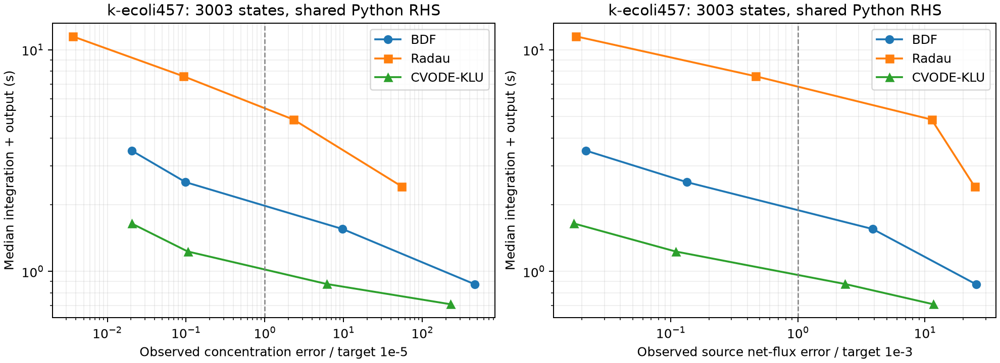
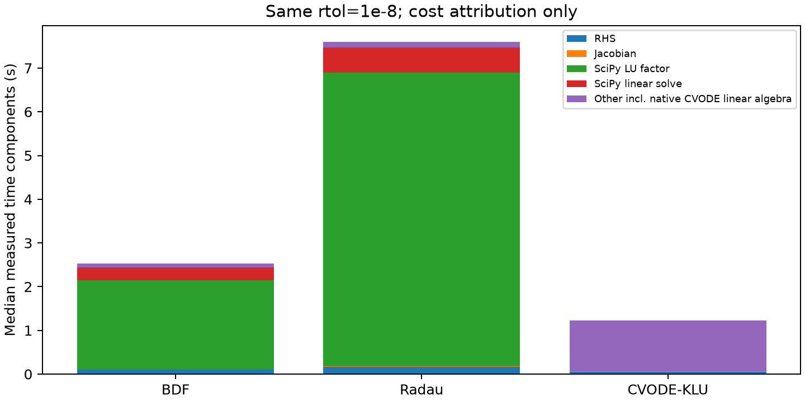
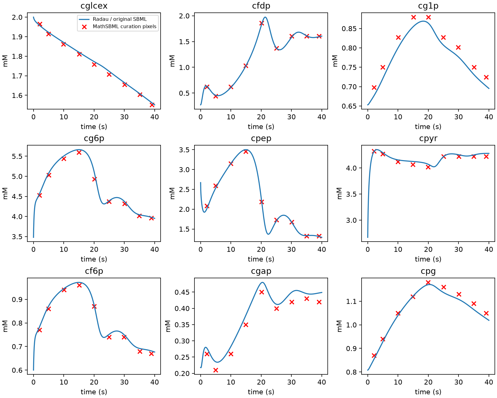

# M1 completion evidence

M1: **complete**; M2 admission: **pass**.

Raw repeated runs, reference arrays, source-executor fixture and gate decisions are stored alongside this table.

k-ecoli457: original aerobic glucose source initialization, ACALD 2x; fixed source-coordinate window [0,1].
All solvers use the same Python RHS and analytic sparse Jacobian in the same Linux runtime. Seven interleaved isolated workers per configuration after warm-up.

| Method | rtol | Median s | IQR s | Concentration E at 1e-5 | Net flux E at 1e-3 | Max worker RSS MiB | Failed |
|---|---:|---:|---:|---:|---:|---:|---:|
| BDF | 1e-04 | 0.875 | 0.025 | 464.6 | 25.25 | 293.1 | 0 |
| Radau | 1e-04 | 2.418 | 0.024 | 54.69 | 24.55 | 294.3 | 0 |
| CVODE-KLU | 1e-04 | 0.711 | 0.031 | 227.4 | 11.6 | 289.6 | 0 |
| BDF | 1e-06 | 1.553 | 0.036 | 9.734 | 3.882 | 292.8 | 0 |
| Radau | 1e-06 | 4.844 | 0.112 | 2.315 | 11.28 | 294.0 | 0 |
| CVODE-KLU | 1e-06 | 0.877 | 0.043 | 6.135 | 2.355 | 289.6 | 0 |
| BDF | 1e-08 | 2.529 | 0.057 | 0.09835 | 0.1334 | 296.4 | 0 |
| Radau | 1e-08 | 7.597 | 0.066 | 0.09275 | 0.4659 | 289.0 | 0 |
| CVODE-KLU | 1e-08 | 1.230 | 0.020 | 0.1048 | 0.1089 | 289.6 | 0 |
| BDF | 1e-09 | 3.510 | 0.122 | 0.02034 | 0.0214 | 295.7 | 0 |
| Radau | 1e-09 | 11.505 | 0.369 | 0.003627 | 0.01788 | 298.6 | 0 |
| CVODE-KLU | 1e-09 | 1.646 | 0.055 | 0.02033 | 0.01723 | 289.6 | 0 |

E≤1 passes the stated metric on the fixed grid. Coarse configurations that fail accuracy remain in the table.
Worker RSS includes inherited model/reference buffers and postprocessing; it is not incremental solver-only memory.
CVODE LU factor time is not exposed separately. Its complete native work remains in total time.

See [M1 completion report](../../docs/m1-completion-report.md) for model eligibility, numerical limits and reproduction commands.
