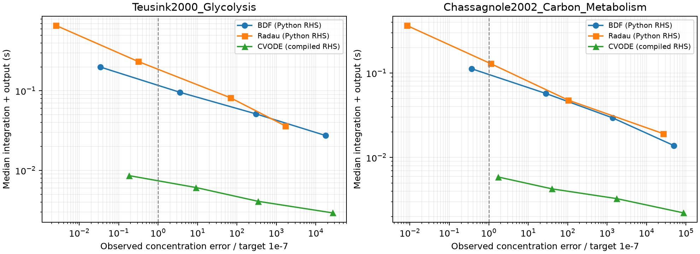

# M1 baseline pilot

Generated from the saved audit and summary JSON files.

Times include integration and common output sampling, after warm-up; median of 7 or more interleaved batches.
CVODE uses compiled RoadRunner RHS and dense default linear algebra; SciPy uses shared Python RHS plus structural Jacobian sparsity.
This is a software baseline pilot, not evidence of splitting speedup.

## Teusink2000_Glycolysis

Dynamic states: 14; reactions: 17; window: 0–10.0 minute; batch size: 7.

| Method | rtol | Median ms / trajectory | IQR ms | Concentration E (1e-7) | Dense grid E (1e-7) | Flux E (1e-7) | Failures |
|---|---:|---:|---:|---:|---:|---:|---:|
| BDF | 1e-03 | 27.443 | 0.702 | 1.766e+04 | 1.821e+04 | 5.206e+04 | 0 |
| Radau | 1e-03 | 36.303 | 0.489 | 1674 | 2130 | 4227 | 0 |
| CVODE | 1e-03 | 2.925 | 0.062 | 2.685e+04 | 2.746e+04 | 4.351e+04 | 0 |
| BDF | 1e-05 | 51.363 | 0.767 | 301 | 301.6 | 399.7 | 0 |
| Radau | 1e-05 | 81.940 | 2.002 | 68 | 71.99 | 80.26 | 0 |
| CVODE | 1e-05 | 4.088 | 0.088 | 344.6 | 808.5 | 959.9 | 0 |
| BDF | 1e-07 | 95.716 | 2.494 | 3.595 | 3.635 | 4.78 | 0 |
| Radau | 1e-07 | 233.429 | 2.971 | 0.3131 | 0.3317 | 0.4694 | 0 |
| CVODE | 1e-07 | 6.094 | 0.143 | 9.11 | 9.383 | 11.03 | 0 |
| BDF | 1e-09 | 198.931 | 2.125 | 0.03421 | 0.03485 | 0.07812 | 0 |
| Radau | 1e-09 | 663.267 | 7.178 | 0.002548 | 0.002626 | 0.003645 | 0 |
| CVODE | 1e-09 | 8.598 | 0.040 | 0.1829 | 0.1839 | 0.1829 | 0 |

E ≤ 1 passes that error metric on the specified grid only. Concentration and flux pass/fail are separate.

## Chassagnole2002_Carbon_Metabolism

Dynamic states: 18; reactions: 48; window: 0–20.0 second; batch size: 10.

| Method | rtol | Median ms / trajectory | IQR ms | Concentration E (1e-7) | Dense grid E (1e-7) | Flux E (1e-7) | Failures |
|---|---:|---:|---:|---:|---:|---:|---:|
| BDF | 1e-03 | 13.857 | 0.443 | 4.907e+04 | 4.907e+04 | 8.587e+05 | 0 |
| Radau | 1e-03 | 19.159 | 0.689 | 2.657e+04 | 2.657e+04 | 3.927e+05 | 0 |
| CVODE | 1e-03 | 2.209 | 0.037 | 8.65e+04 | 8.65e+04 | 1.105e+06 | 0 |
| BDF | 1e-05 | 29.445 | 0.547 | 1385 | 1385 | 1.776e+04 | 0 |
| Radau | 1e-05 | 47.861 | 0.636 | 102.9 | 102.9 | 2038 | 0 |
| CVODE | 1e-05 | 3.262 | 0.102 | 1740 | 1740 | 3.054e+04 | 0 |
| BDF | 1e-07 | 57.395 | 1.332 | 27.8 | 27.8 | 339.3 | 0 |
| Radau | 1e-07 | 129.304 | 2.292 | 1.121 | 1.121 | 31.17 | 0 |
| CVODE | 1e-07 | 4.255 | 0.140 | 39.88 | 39.88 | 484.8 | 0 |
| BDF | 1e-09 | 112.446 | 3.303 | 0.3683 | 0.3683 | 4.725 | 0 |
| Radau | 1e-09 | 366.608 | 4.951 | 0.008328 | 0.008305 | 0.5152 | 0 |
| CVODE | 1e-09 | 5.881 | 0.115 | 1.725 | 1.725 | 5.529 | 0 |

E ≤ 1 passes that error metric on the specified grid only. Concentration and flux pass/fail are separate.

See ../../docs/m1-baseline-report.md for reference checks, scope and remaining acceptance gates.
